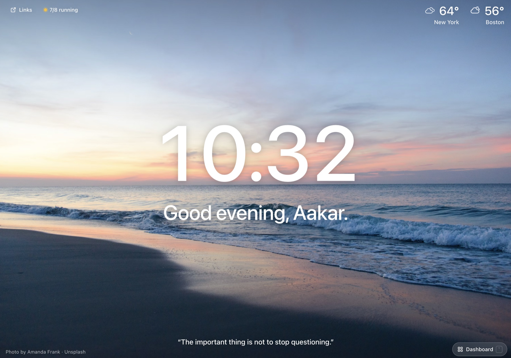
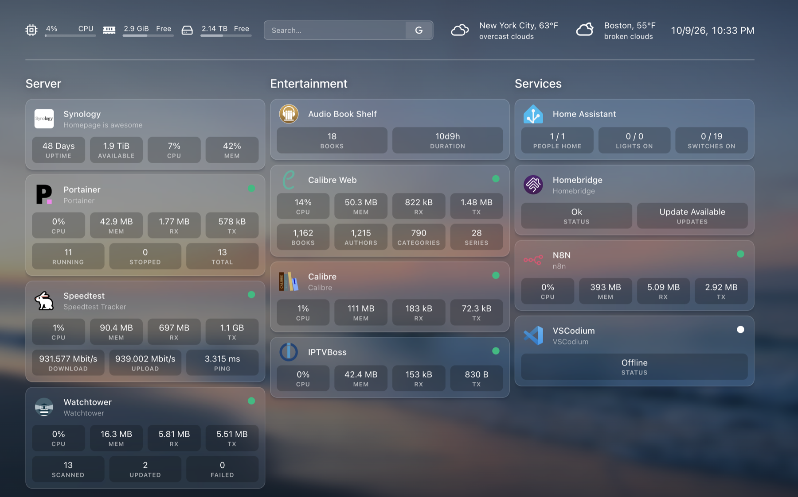

# Homepage Focus View

I've used Momentum as my browser's new tab page for years. I also run [Homepage](https://gethomepage.dev) for my homelab. I wanted both on one page, so I wrote this.

It's two files, `custom.js` and `custom.css`. Homepage already loads both from your config folder. The page opens to a full-screen photo with the time, a greeting, a quote and the weather. Press the backtick key (`` ` ``) or the button in the bottom right to switch to your regular Homepage dashboard and back.




## What you get

**Focus view**
- A new background photo every day, with a credit to the photographer
- A big clock and a greeting that changes with the time of day
- A daily mantra that swaps in for the greeting after you've had the page open a few minutes. Click it to switch back.
- A daily quote at the bottom. Hover over it to see who said it.
- Weather for each city in your `widgets.yaml`. Click a city for feels like, humidity and wind.
- A Links menu built from your `bookmarks.yaml`
- A count of running containers, if your services use Docker

**Dashboard view**
- Your normal Homepage, with frosted cards over the same photo
- Service stats refresh every 15 seconds while it's open. On its own, Homepage only refreshes them when the window regains focus.

The photo, quote and mantra change at 4am. Quick launch works in both views, so you can start typing to jump to a service.

## Requirements

- Homepage. I built this on v2.4.0.
- For weather: at least one `openweathermap` widget in `widgets.yaml`, with an OpenWeather API key set the normal Homepage way. If you don't have one, everything else still works and the weather just doesn't show.

```yaml
- openweathermap:
    label: New York City
    latitude: 40.7667
    longitude: -73.9921
    units: imperial
    provider: openweathermap
    cache: 5
    href: https://www.wunderground.com/weather/us/ny/manhattan/10019 # optional
```

Each one shows up as its own city, in the same order as in the file. `label` is the name under the temperature. `href` is where "Full forecast" goes when you click a city. Without it, the link goes to OpenWeather.

Other weather widgets (Open-Meteo, WeatherAPI) aren't supported yet.

## Install

1. Copy `custom.js` and `custom.css` into your Homepage config folder, the one with `settings.yaml` in it. With Docker, that's whatever you mounted to `/app/config`.
2. If you already have a `custom.js` or `custom.css`, merge them or back yours up first.
3. Reload Homepage.

## Make it yours

Open `custom.js`. Everything you'd want to change is in the `CONFIG` block at the top, and lines marked `<-- EDIT` are personal to me:

- `name`: the name in the greeting. Leave it as `""` to just get "Good morning."
- `weatherNames`: shorter names for your cities, keyed by `label`, like `{ "New York City": "New York" }`
- `dayStartsAt`, `toggleKey`, `mantraSwapMinutes`, `dashboardRefreshSeconds`: fine as they are, but there if you want them

Under that are the `PHOTOS`, `QUOTES` and `MANTRAS` lists. Add, remove or swap anything you like. For photos, use the `photo-XXXX-XXXX` part of an `images.unsplash.com` link.

For the look, open `custom.css` and change the variables in the `CUSTOMIZE` block: font, background color, how dark and blurry the photo gets behind the dashboard, and the card colors.

Optional: if you want quick launch to also search the web, add this to `settings.yaml`:

```yaml
quicklaunch:
  searchDescriptions: true
  showSearchSuggestions: true
  provider: google
```

## Good to know

- The CSS hooks into Homepage's page structure. If a future Homepage release changes it, some styling may need a small fix. If something looks off after an upgrade, that's the first place I'd look.
- If `custom.js` fails to load for any reason, you get the stock Homepage back after a couple of seconds instead of a blank page.
- If your computer has "Reduce motion" turned on, the animations switch off.
- To remove it, delete the two files (or empty them) and reload.

## Credits

The idea comes from [Momentum](https://momentumdash.com). This isn't affiliated with them. Photos are from [Unsplash](https://unsplash.com) and credited on screen. Quotes belong to the people credited with them.

## License

MIT
